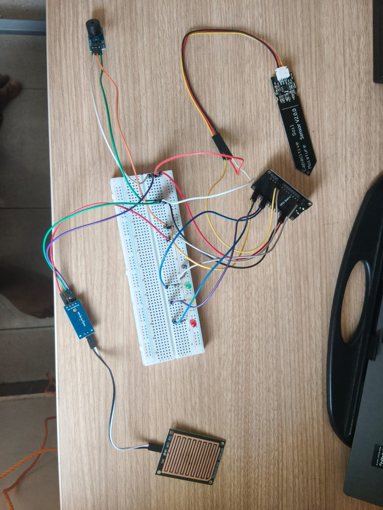
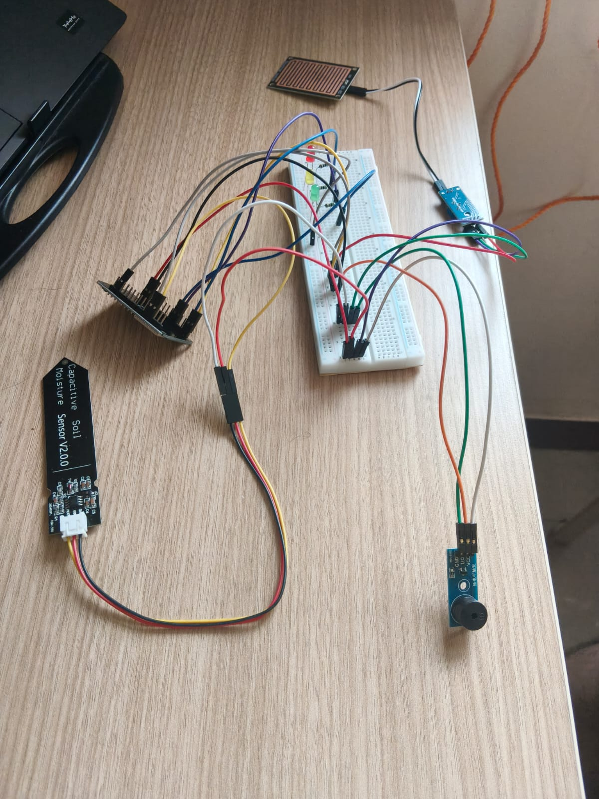

# Smart IoT Enabled Soil Erosion Control System

## About the Project

This is my BTech ECE mini project. The main aim of this project is to monitor soil moisture and rainfall using IoT technology and identify possible soil erosion risk conditions.

I have used an ESP32 microcontroller along with soil moisture and rain sensors. Based on the sensor values, the system indicates the risk level using LEDs and a buzzer.

## Components Used

- ESP32 DevKit V1
- Soil Moisture Sensor
- Rain Drop Sensor
- Green LED
- Yellow LED
- Red LED
- 3-pin Buzzer Module
- Breadboard
- Jumper Wires

## Software Used

- Arduino IDE
- ThingSpeak
- Telegram Bot
- Wi-Fi

## How It Works

1. The soil moisture sensor checks the moisture level in the soil.
2. The rain sensor detects rainfall.
3. The ESP32 reads both sensor values.
4. Based on the readings, the system displays the risk condition.
5. LEDs indicate the risk level:
   - Green – Low Risk
   - Yellow – Moderate Risk
   - Red – High Risk
6. The buzzer gives an alert when high-risk conditions are detected.
7. Sensor readings are uploaded to ThingSpeak, where graphs can be viewed.
8. Telegram notifications are used to send alerts.

## IoT Implementation

I have connected the ESP32 to Wi-Fi and integrated ThingSpeak for monitoring sensor readings through graphs. Telegram is also used for receiving notifications.

## Future Improvements

- Adding a water level sensor.
- Adding a servo motor for automatic control.
- Improving the risk detection system.

## Project Status

The basic sensor monitoring, LED indicators, buzzer alert and IoT data uploading have been implemented.

## Project Details

**Course:** BTech – Electronics and Communication Engineering

**Project Type:** Mini Project
## Project Photos

### Front View


### Back View

## System Block Diagram

```mermaid
flowchart TD
    A[Soil Moisture Sensor] --> C[ESP32 DevKit V1]
    B[Rain Drop Sensor] --> C
    C --> D[Green LED - Low Risk]
    C --> E[Yellow LED - Moderate Risk]
    C --> F[Red LED - High Risk]
    C --> G[Buzzer Alert]
    C --> H[Wi-Fi Connection]
    H --> I[ThingSpeak IoT Cloud]
    I --> J[Live Sensor Graphs]
    C --> K[Telegram Bot]
    K --> L[Mobile Alert]
    ## Circuit Connection Diagram

```mermaid
flowchart TB
    subgraph INPUTS
        A[Soil Moisture Sensor]
        B[Rain Drop Sensor]
    end

    subgraph ESP32
        C[ESP32 DevKit V1]
    end

    subgraph OUTPUTS
        D[Green LED - GPIO 19]
        E[Yellow LED - GPIO 21]
        F[Red LED - GPIO 22]
        G[Buzzer - GPIO 23]
    end

    A -->|AO - GPIO 34| C
    B -->|AO - GPIO 35| C
    C --> D
    C --> E
    C --> F
    C --> G

